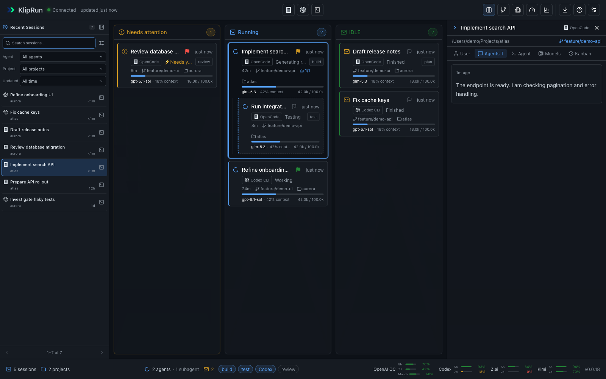
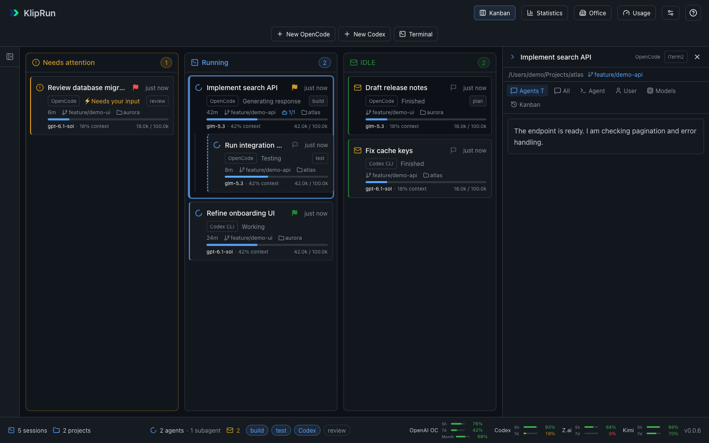
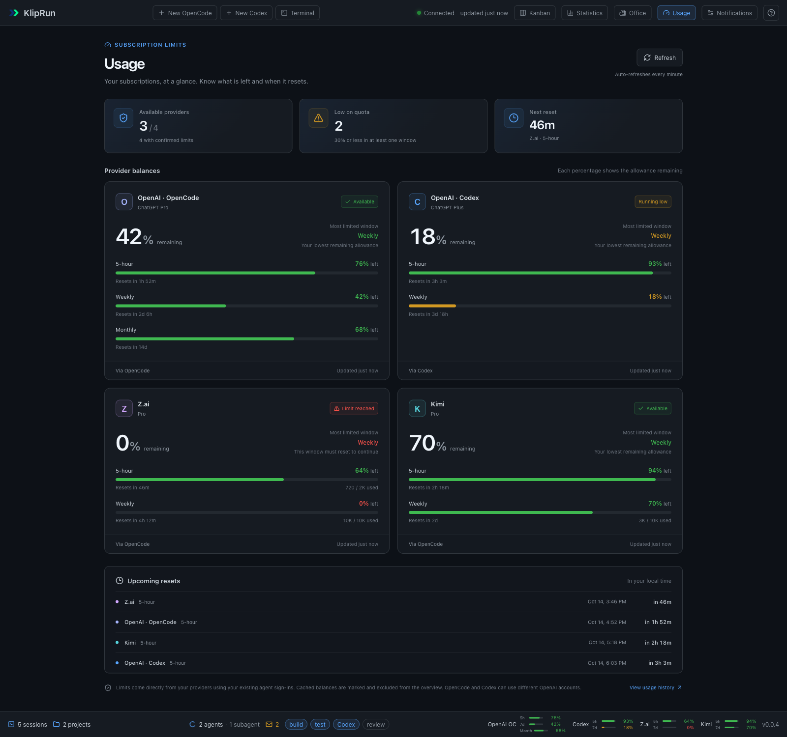

# KlipRun Desktop

KlipRun is a macOS app for following OpenCode and Codex sessions in one place. It shows a Kanban board, an animated Office view, usage statistics, notifications, and live terminal tabs for agents you start inside the app.

## Install

The downloadable build is for **Apple Silicon Macs running macOS 13 or newer**.

1. Download `KlipRun-0.0.4-macos-arm64.zip` from the [latest release](https://github.com/klipbn/kliprun_desktop/releases/latest).
2. Unzip it and move `KlipRun.app` to **Applications**.
3. Open the app. The release is signed locally but is not notarized, so macOS may block the first launch. If it does, go to **System Settings → Privacy & Security → Open Anyway**, then open KlipRun again.

Install and sign in to [OpenCode](https://opencode.ai/) or [Codex CLI](https://github.com/openai/codex) separately. KlipRun does not include either CLI or its credentials.

## Screenshots

All sessions, project paths, and usage numbers shown below are fictional examples. [See the screenshot fixture and more views](docs/screenshots/README.md).

### Recent sessions

Browse recent OpenCode and Codex sessions, inspect their details, and resume them in the original agent and project folder.



### Board and terminal


### Kanban and session details



### Office


### Statistics


### Subscription limits



## Use

- **Kanban** shows active sessions and those needing attention. Click a card to inspect its activity.
- **Running** keeps cards in arrival order while they stay in the column; new arrivals appear at the bottom.
- **Recent Sessions** on the left lists the latest 50 top-level sessions. Click a title for details or **Resume in Terminal** to continue the same Codex or OpenCode session in its original folder. An existing matching tab is selected when available. The panel remembers whether it is collapsed.
- **Kanban** next to **Statistics** returns to the board from any view. **Office** shows the same agents as animated coworkers; the coworker matching the selected terminal has a blue outline and a **Terminal** badge, just like the board card.
- **Statistics** opens on the last 30 days. Daily and Weekly token heatmaps, token composition, peak-day and leading-model/project highlights, trends, work patterns, and task rankings share the same date and source filters. Choose a token type, click a day or week to explore it, and use **Back to previous range** to return. The task list includes calls and tokens per call. **Last 90 days** reveals longer-term patterns; **Export daily CSV** saves exact totals through the macOS save dialog.
- **Usage** next to Office (**Control+4**) shows remaining subscription allowances for OpenAI via OpenCode, OpenAI via Codex, Z.ai, and Kimi. Cards show each available limit window, the lowest remaining allowance, and reset times; the overview highlights available providers, low balances, and the next reset. Limits refresh every minute while the app is open, or with **Refresh**.
- The **bottom status bar** shows compact remaining-limit bars and percentages for up to six connected providers. Available 5-hour and weekly windows appear separately; other periods keep their own labels. Hover for reset times or click a provider to open Usage. Cached balances and pending resets are marked in gray. The limits wrap onto another row in narrow windows.
- **New OpenCode** and **New Codex** ask you to choose a project folder, then start the agent in the terminal panel.
- **⌘T** lets you choose OpenCode, Codex, or a plain terminal. A plain terminal opens in the selected tab's folder, or your home folder when no tab is selected.
- Click **Terminal** to show or hide the terminal area. Tabs keep running while hidden. Closing an active tab or quitting the app asks before ending its process.
- Use the position button beside **+** in the terminal toolbar to switch between **Move terminal to left** and **Move terminal to bottom**. Drag the divider to adjust the pane; its position, bottom height, and left width are remembered independently. Moving the panel keeps the current terminal and dashboard view open.
- Exiting an agent or shell automatically closes its terminal tab. The terminal area hides after the last tab exits.
- **⌘W** closes the visible selected terminal tab, with confirmation for a running process. It is disabled when the terminal area is hidden or empty. **⌘Q** quits the app.
- Click **?** in the upper-right corner for every keyboard shortcut. The neighboring **Notifications** button controls the coworker popup.

KlipRun reads existing OpenCode and Codex session data without changing their stores. Its bundled engine runs on a random local loopback port and requires an app-generated token. App preferences and its own state live in `~/Library/Application Support/KlipRun Desktop`.

Usage reads OpenCode's `auth.json` beside its database (normally `~/.local/share/opencode/auth.json`, honoring `XDG_DATA_HOME`) and Codex's `auth.json` in `CODEX_HOME` (normally `~/.codex`). The local engine makes read-only requests directly to the providers' quota APIs; credentials stay in the engine and are never sent to the web interface. OpenAI subscription limits require a ChatGPT sign-in; API-key-only accounts cannot provide them. For an expired sign-in, open the corresponding agent to renew it, then refresh Usage. Last successful balances stay in memory while the app runs; on a provider failure they are marked **Cached** and excluded from the overview. Missing or unsupported limits stay unknown. OpenCode and Codex may use different OpenAI accounts; cards are separate sources, not additive allowances. Statistics remains the place for historical token consumption.

Statistics heatmaps use the selected time zone and Monday-based calendar weeks. Colors are relative to the busiest day or week for the selected token type. Current days and clipped weeks are marked as partial; empty cells mean no recorded usage. Calls without a known date remain in all-time totals and are excluded from calendar cells. Input, cache read/write, output, and reasoning are counted without overlap. The input cache ratio uses all input tokens as its denominator; it is not an estimate of money saved. CSV exports include date boundaries, timezone, every token component, call counts, and partial/incomplete flags. Heatmap mode and token type are preserved in the Statistics URL.

## Build from source

You need macOS, a **Swift 6 toolchain** (Xcode or Command Line Tools), and [Bun](https://bun.sh/) 1.4 or newer. The script detects your installed macOS SDK and Bun executable.

```sh
git clone https://github.com/klipbn/kliprun_desktop.git
cd kliprun_desktop
zsh scripts/build.sh
open dist/KlipRun.app
```

After building, run the checks:

```sh
zsh scripts/test.sh
cd engine && bun run test
```

The app uses SwiftUI, AppKit, WebKit, a local Bun engine, and a vendored copy of SwiftTerm. The application is MIT licensed; see [LICENSE](LICENSE) and [SwiftTerm's license](vendor/SwiftTerm/LICENSE). The engine and web UI are based on the original [KlipRun](https://github.com/klipbn/kliprun) project.

See [CHANGELOG.md](CHANGELOG.md) for release history.
