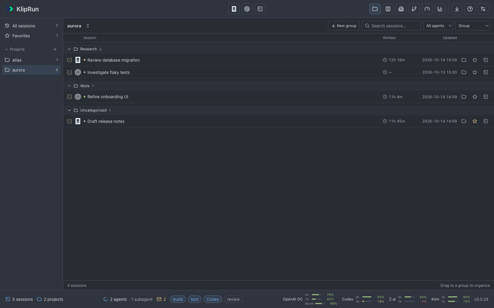
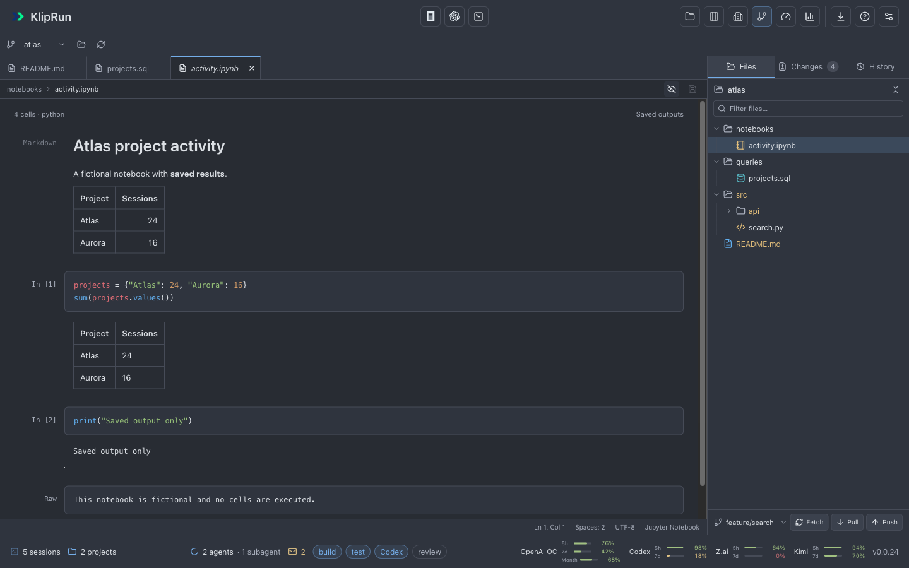

# KlipRun Desktop

A macOS app for OpenCode and Codex sessions: a Kanban board, embedded terminals, repository file editing and Git diffs, searchable session history, and usage statistics.

## Screenshots








[More screenshots](docs/screenshots/README.md), including terminals and statistics. All examples use fictional data.

## Install

Requires **Apple Silicon and macOS 13+**.

1. Download `KlipRun-0.0.24-macos-arm64.zip` from the [latest release](https://github.com/klipbn/kliprun_desktop/releases/latest).
2. Unzip and move `KlipRun.app` to **Applications**. Quit KlipRun before replacing an older version.
3. Open the app. If macOS blocks it, use **System Settings → Privacy & Security → Open Anyway**. The build is locally signed and not notarized.

Install and sign in to [OpenCode](https://opencode.ai/) or [Codex CLI](https://github.com/openai/codex) separately. Git requires the macOS command line tools (`xcode-select --install`).

Starting with 0.0.18, use **Check for Updates → Download Update → Install and Restart**. KlipRun verifies and prepares the update, closes the Updates panel, replaces its current copy, and reopens with **What's New**. No manual ZIP extraction or copying is needed for subsequent updates. If **Install and Restart** does nothing in 0.0.16 or 0.0.17, follow the installation steps above once, quitting KlipRun before replacing it. Upgrading from 0.0.15 or earlier also requires these steps once. The app must be in a writable folder. Restarting asks before ending agents running in embedded terminals; preferences and session history are preserved.

The **Git** repository menu supports search by name or path and keyboard selection. The resizable project panel sits on the right; **Files** is before **Changes**. Its tree shows tracked and nonignored new files from the selected repository, with file-type icons, Git status colors, a filename filter, and keyboard navigation.

Right-click a file or folder (or press **Shift+F10**) to open its menu: open, rename, copy the absolute or relative path, **Reveal in Finder**, **Open in Default App**, and **Add to .gitignore**. Drag files or folders onto another folder to move them; drop on the repository heading to move to the root. Moves preserve the Git index and refuse existing destination names. Unsaved affected files offer the save/discard dialog first. Ignore rules use literal paths in the root `.gitignore`; already tracked files remain tracked. **Collapse all folders** is available in both Files and Changes.

The compact repository control shows its name, with the full path on hover; adjacent folder and refresh icons keep the toolbar short. **Changes** uses dense file rows with staging toggles, status colors and change counts. **Commit staged** continues to commit only staged files. **History** searches the loaded commits by message, author, hash or ref; use the arrow keys to move between commits. Selecting a commit opens its first file diff, while the changed-file list lets you choose another. Closing that diff keeps it closed across refreshes.

File editing follows [Zed's preview-tab conventions](https://zed.dev/docs/reference/all-settings#preview-tabs): a single click opens a temporary tab; double-clicking or editing keeps it open. Open files retain their own drafts and undo history while switching tabs. Close a tab with **×**; unsaved files offer **Save and close**, **Discard changes**, or **Keep editing**. Changing repositories checks inactive dirty tabs too. Drafts survive switching to another KlipRun view within the current app session; save before quitting.

The editor includes Python, SQL, Markdown, JavaScript/TypeScript, and JSON highlighting; line numbers, folding, active-line and matching-bracket highlights; **Tab / Shift+Tab** indentation, automatic indentation, undo/redo, and **Command+F** search. Breadcrumbs show the path, and the status bar shows the cursor position and language. The eye button toggles rendered Markdown. **Save / Command+S** writes the current file and briefly shows **Saved**. Files are never executed. The editor accepts existing UTF-8 text files up to 512 KiB and Jupyter notebooks up to 10 MiB, and checks their revision before saving to detect changes on disk. The Git workspace uses a One Dark palette under the Midnight app theme and follows any explicitly selected palette.

**Jupyter notebooks (.ipynb)** open as readable cells: rendered Markdown, highlighted code, execution counts, and saved outputs including text, HTML tables, PNG/JPEG/GIF/WebP images, and errors. Markdown attachments are supported. The eye button switches between the notebook preview and its editable JSON source; previewing preserves the original file and creates the JSON editor only when needed. Cells are never run, HTML output is sanitized, and external images and links are inactive. Notebook format 4 is supported; invalid or older files show a message with access to the JSON source. Large HTML outputs and interactive Plotly charts show a notice and their text fallback; long text outputs are shortened in preview. Full results remain in the saved source and can be viewed with **Open in Default App**. Interactive widgets and SVG-only outputs require their text fallback.

**Statistics → Latest sessions** shows the latest 5, 10, 20, or 50 sessions within the selected period and filters, including subagents, token breakdowns, observed time, calls, and recorded costs. The chosen count is remembered. **Cached input** means tokens read from the cache; it is separate from uncached input and cache writes, so totals do not double-count tokens.

**Sessions** opens before Kanban in the toolbar. **All sessions** lists assigned projects first and **No project** last; **Favorites** keeps starred sessions nearby. Create projects with **+**, then select a project to create groups such as Research and Work. Sessions without a group appear under **Uncategorized**. Use checkboxes and **Move to…**, the row's folder button, or drag sessions onto a project or group; **Undo** restores the previous assignment. Organization is saved by KlipRun and never changes the original agent folder. New installations start on Sessions; an existing startup choice is preserved in Settings.

Search covers the complete indexed root-session history, including project and group names; lists show 100 sessions per page. **Worked** is observed running time, excluding idle periods and child agents; missing measurements show **—**. **Updated** shows the full local date and time as `YYYY-MM-DD HH:mm`, including in narrow windows. Selecting a session opens its details; the terminal button resumes it in its original agent. Kanban no longer has a Recent Sessions sidebar.

Navigation shortcuts follow toolbar order: **Control+1 Sessions**, **Control+2 Kanban**, **Control+3 Office**, **Control+4 Git**, **Control+5 Usage**, **Control+6 Statistics**. **Command+1–9** continues to select terminal tabs.

**Office** offers three saved floor plans: **Shared loft**, **Team rooms**, and **Long studio**. Crowded floors add desk columns to use the window's width, and Team rooms can spread across additional columns. Coworkers walk between working, meeting, and lounge areas as session states change. Larger team leads check on their smaller subagents; labels and team connections show which sessions belong together. Use **Office settings** to toggle names, connections, and movement; app and system reduced motion take priority. **Fit**, zoom, and dragging keep the floor accessible beside the terminal, while **Find a task** selects any coworker by title. The trophy button opens the token-usage leaderboard.

Codex subagents appear with their confirmed parent session, including nested helpers. Active helpers share their parent's card when they are in the same column and appear separately when their status differs. Finished helpers stay in the parent's counters; failures appear in its error badge. Subagents do not need a separate terminal.

Codex questions appear in **Needs attention** on Kanban and **Waiting** in Office. Asynchronous questions keep that status until the next user message, including while Codex continues other work or finishes its turn. A tool acknowledgement does not count as an answer; interrupted or failed turns clear the outstanding question.

**Open session** in a notification shows the session's details in the current Office or Sessions view. From other views, it opens Kanban.

When an agent or subagent disappears from the observed board, its Office character walks to the **EXIT** door before leaving the scene. If the session returns on the way, the character resumes its place. Departing characters are excluded from live counts and cannot open stale session details. Reduced motion or disabled animations removes them without walking.

The Office character is called **Klopik**. In **Settings → Appearance → Klopik skins**, choose **Default**, **Robot**, **Astronaut**, **Knight**, **Wizard**, or **Explorer**. Default preserves the original character. Each new set has four equipment variations, assigned consistently by session identity to agents and subagents. The selected set applies immediately to Office and leaderboard avatars and survives app restarts; status updates and card order do not shuffle a Klopik's variation.

For keyboard shortcuts, click the **?** button in the app toolbar. The macOS **Help → KlipRun Help** menu opens this guide, and **Help → Report an Issue…** opens GitHub Issues.

The macOS menu bar follows the active pane. **File** creates agent sessions, terminals and projects, opens repositories (Command+O), saves the active file (Command+S), and closes the active item (Command+W). In the editor, Close uses the existing save/discard dialog; in a focused terminal, it uses the process-ending confirmation. Command+Shift+W closes the window. Unsaved file drafts block window closing and quitting until they are saved or discarded in Git.

**Edit** keeps macOS Cut/Copy/Paste and Select All. Undo/Redo targets CodeMirror when editing code and the native text field otherwise. Find (Command+F), next match (Command+G), and previous match (Command+Shift+G) work in the file editor or focused terminal. **Navigate → Find Session** (Command+Shift+F) opens session search. **View** contains terminal visibility, placement, expansion, workspace focus, zoom, full screen (Control+Command+F), and **Refresh Data** (Command+Shift+R), which preserves file drafts. **Terminal** contains tab selection, cycling (Control+Tab / Control+Shift+Tab), rename, close, and opening the selected session in iTerm2. Standard **Window** controls remain available; **Help** adds shortcuts, diagnostics and the app data folder.

Choose a palette in **Settings → Appearance → Select Theme**. **Graphite** is the default palette. **Midnight** is the renamed original Default palette and keeps its colors. **Ember**, **Dusk**, **Graphite**, **Daybreak**, and **Paper** use the colors of Zed's Ayu Dark, Ayu Mirage, One Dark, Ayu Light, and One Light themes, respectively. The choice is saved and applied immediately to the interface and open terminals. Terminals open on the **left** by default; Settings → Terminal → Terminal position offers **Left** then **Bottom**. Reset terminal settings restores Left. Existing saved theme and position choices are preserved.

## Build

Requires macOS, **Swift 6** (Xcode or Command Line Tools), and [Bun 1.4+](https://bun.sh/).

```sh
git clone https://github.com/klipbn/kliprun_desktop.git
cd kliprun_desktop
zsh scripts/build.sh
open dist/KlipRun.app
```

Run tests:

```sh
zsh scripts/test.sh
cd engine && bun run test
```

[Changelog](CHANGELOG.md) · [MIT license](LICENSE) · Based on [KlipRun](https://github.com/klipbn/kliprun) and [SwiftTerm](vendor/SwiftTerm/LICENSE).
