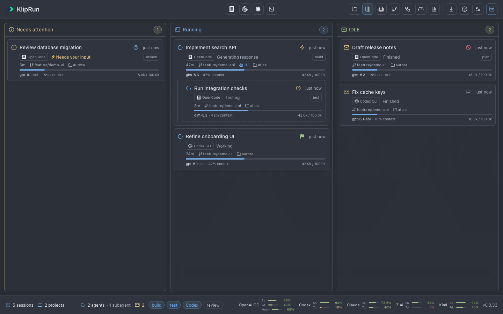
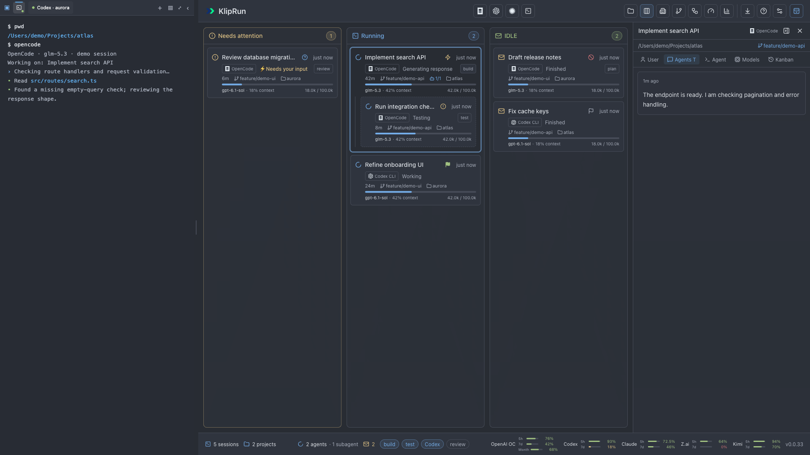
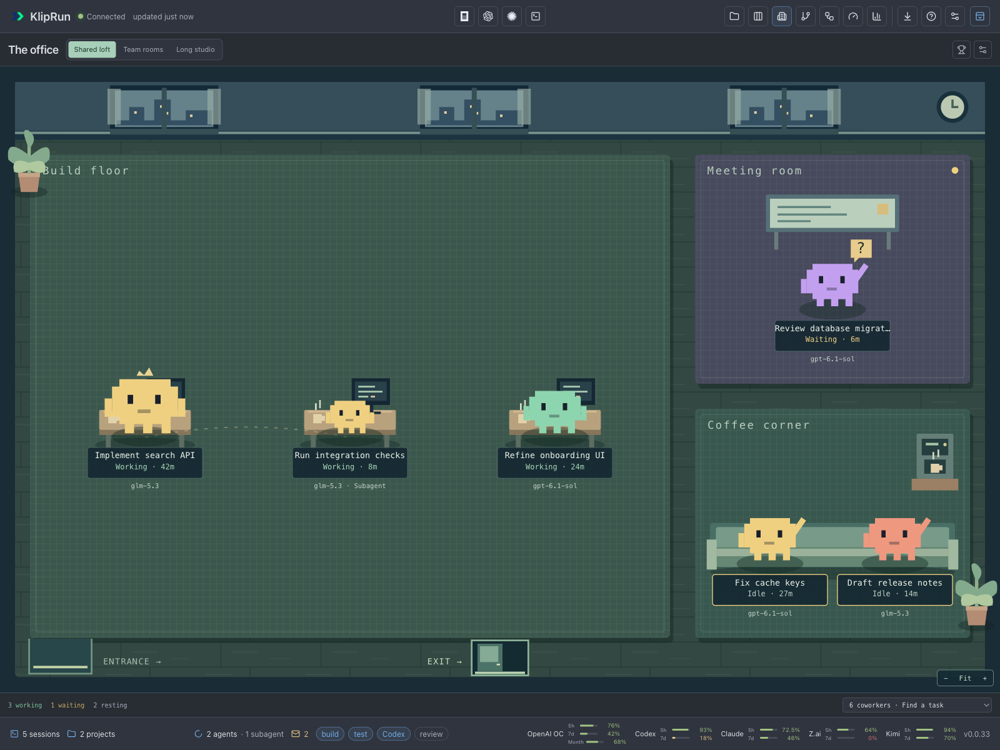
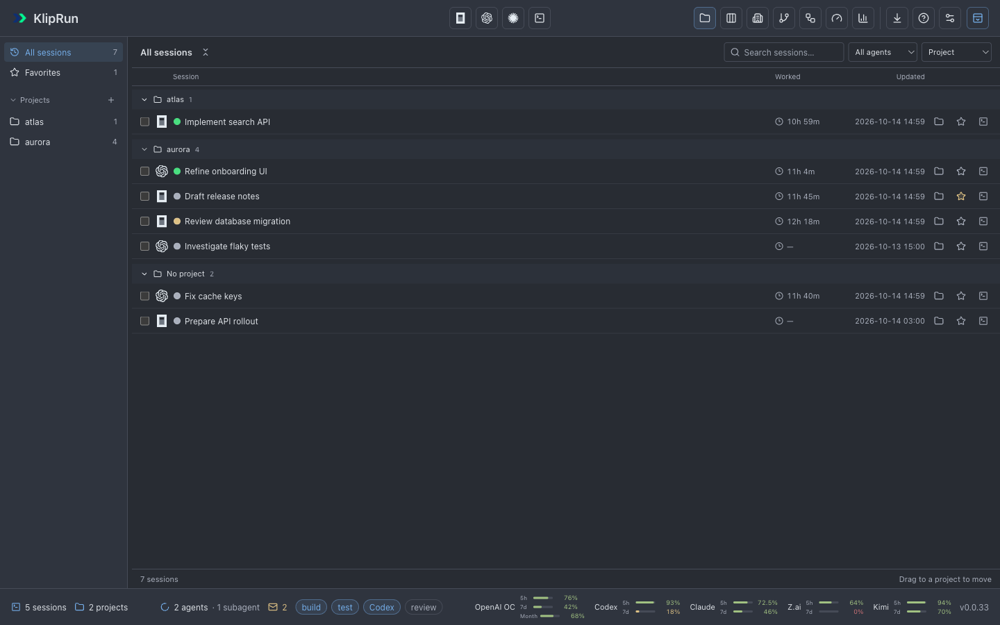
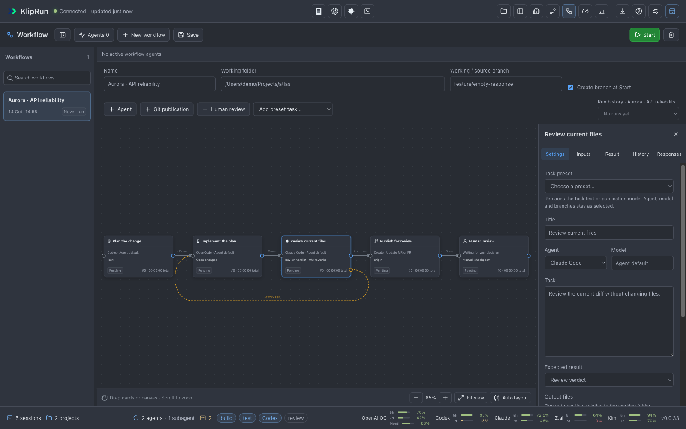
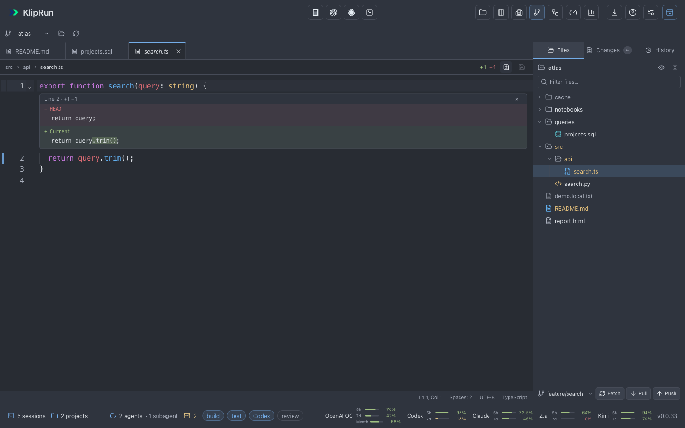
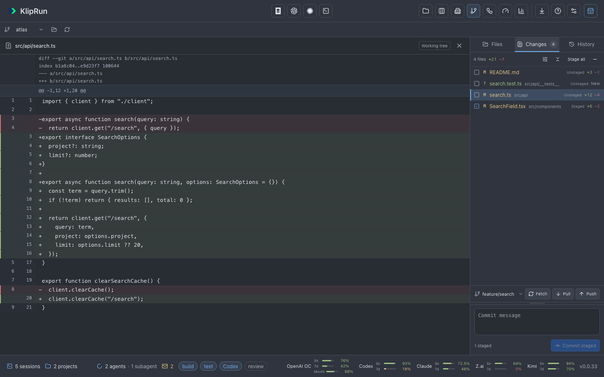
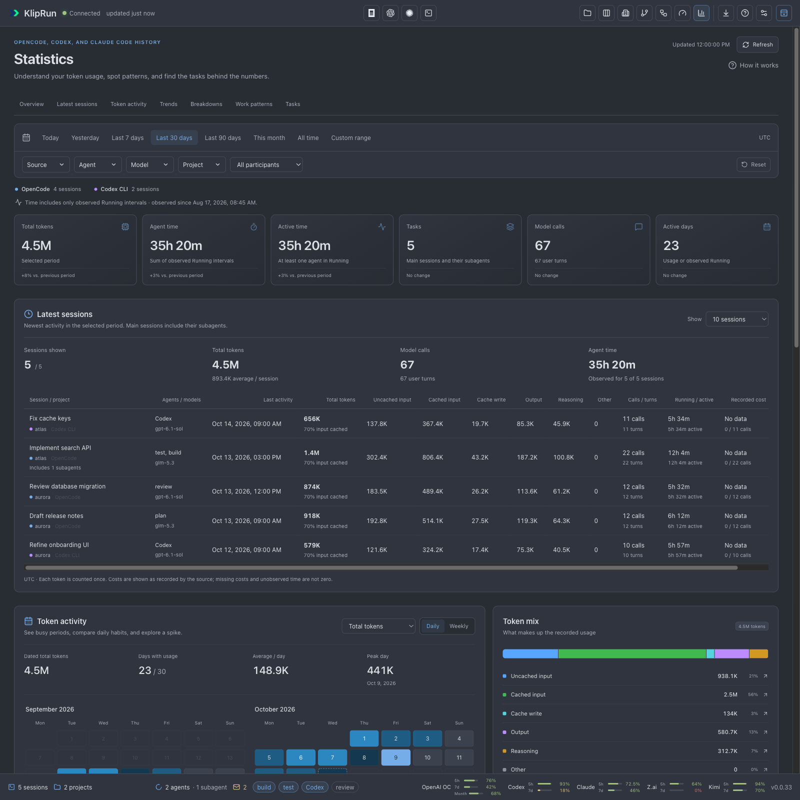

# KlipRun Desktop

A macOS app for OpenCode, Codex, and Claude Code sessions: a Kanban board, embedded terminals, linked-card workflows, repository file editing and Git diffs, searchable session history, and usage statistics.

## Screenshots





Show or hide the embedded terminal with **⌘J**; click a session card to open its details.
On Kanban, **Hide details** tucks the panel to the right without changing the
selected session, and **Show details** brings it back. **Close details** clears
the selection.
Kanban cards use neutral outlines; column headings and card icons show their status.
Choose Critical, Medium, Low, Question (?), Warning (!), Urgent (⚡) or Blocked (⛔)
from a themed per-card priority menu. **No priority** clears the marker.

Click **Show labels** at the right edge of the top toolbar to expand it: agent
and utility buttons show their names on the first row, and workspace views move
to a second row. **Hide labels** returns to compact icons. The app remembers the
choice across refreshes and restarts; new installations start compact. In Office,
use **Kanban** in this toolbar to return to the board.













[More screenshots](docs/screenshots/README.md). All examples use fictional data.

## Install

Requires **Apple Silicon and macOS 13+**.

1. Download `KlipRun-0.0.33-macos-arm64.zip` from the [latest release](https://github.com/klipbn/kliprun_desktop/releases/latest).
2. Unzip and move `KlipRun.app` to **Applications**. Quit KlipRun before replacing an older version.
3. Open the app. If macOS blocks it, use **System Settings → Privacy & Security → Open Anyway**. The build is locally signed and not notarized.

Install and sign in to [OpenCode](https://opencode.ai/), [Codex CLI](https://github.com/openai/codex), or [Claude Code](https://code.claude.com/docs/en/overview) separately. Git requires the macOS command line tools (`xcode-select --install`).

## Workflow

Open **Workflow** immediately after **Git** in the toolbar, or use **Control+5**. **New workflow** asks for a name and working folder, then offers an empty canvas or an editable **Plan → Implement → Review → Publish → Human** template. These names have no special behavior: each agent card has its own agent, model, task, result type, output files and completion condition. Model suggestions come from the installed agents' catalogs; a model ID can also be entered, as in Agents settings. An empty model uses that agent's saved default.

Drag cards to arrange them. Click an output dot and then another card's input dot to connect them; select an arrow to delete it or change its rework limit. Scroll to zoom, drag the canvas to pan, or use the zoom buttons and **Fit view**. Inspect Settings, Inputs, Result, History and Responses on the right. Drafts, positions, viewport and selection save automatically. The collapsible Workflow list shows each name, date and last-run state. Drag the dividers to resize the list and Task details; dimensions and visibility are saved. Responses displays assistant prose as Markdown and turns review JSON into a verdict, summary and findings. New runs store bounded assistant responses and compact recovery records instead of raw tool logs.

**Run history** shows only the selected workflow's runs and identifies that workflow by name. Switching workflows clears the previous run selection. The sidebar supports name search and a **…** menu (also available on right-click) with **Rename**, **Hide workflow / Show workflow**, and **Delete**. Hidden workflows remain accessible through **Hidden** and keep executing; renaming leaves saved run snapshots intact. Delete uses an in-app confirmation, removes the workflow and its history, keeps project files, and requires any active run to be stopped first. Dates include local hours and minutes; task and agent durations use **HH:MM:SS**, including seconds after an hour. **Auto layout** arranges cards in the order defined by forward arrows, and **Run order** in the inspector lists the sequence when no task is selected. These compact controls take cues from the [Kangentic demo](https://kangentic.github.io/kangentic/stage.html).

**Start** validates one connected sequence. Only review return arrows may form a loop. One card runs at a time, sharing the folder and selected working branch. Each card receives its task, current earlier results (including the plan), file paths and latest feedback. Declared output files must exist inside the working folder. Code review reads the real files and diff. Old attempts remain in History; returning to an earlier card invalidates subsequent current results.

Use **Add preset task** or **Task preset** in the inspector for code, text and file/data reviews, Commit & Push, or Create / Update MR or PR. Presets leave agent/model and branch choices under your control. The **Agents** panel lists active Workflow agents across workflows, including elapsed time, last activity and PID when available; select one to inspect its task and use Pause/Stop if needed. Task cards show total execution time summed across attempts and repeated runs. KlipRun shows its existing popup notification when a workflow completes, reaches human review or needs attention, even while another section is open; clicking it opens the matching workflow. Existing notification and sound preferences apply.

Review cards return JSON with `verdict` (`approved`, `changes_requested` or `needs_input`), `summary`, and `findings` containing `id` and `message`. Approval requires no findings; changes requested requires actionable findings. Invalid/missing results stop progress. A limit of 3 means at most three automatic returns, followed by **Needs attention** if review still requests changes. Every review uses a fresh agent session. Other cards return ordinary text. An agent that needs clarification should begin its response with `NEEDS_INPUT:`; the supplied prompt explains this convention.

For a Git workflow, select the current branch or enter another local branch; **Create branch at Start** creates a new one. Code/publication workflows require a clean working copy at Start. KlipRun never automatically resets, cleans or stashes files. An active run reserves its working folder against other managed workflows, including while paused. **Pause** interrupts the owned agent and prevents another step from starting. **Resume / Retry** uses current files and any additional input. **Stop** retains results and ends only the run's owned execution. Changing sections does not stop a run.

Git publication is a service card with **Commit & Push** or **Create / Update MR or PR**. Its working/source branch is independent of its MR/PR target branch; choose the target explicitly. Start shows the selected remote, branches and title and asks for publication permission once for that run, including its rework passes. Publication commits only the reviewed file set, never creates an empty commit, verifies the approved content, uses a normal push, and reconciles the remote and matching request before retrying. Use `{{results}}` in the description to include current earlier results. GitHub uses `gh`, GitLab uses `glab`; install the appropriate CLI and sign in to the selected host (`gh auth login` / `glab auth login`). Corporate remotes can select the provider explicitly. Missing CLI/access stops the card with a reason. No automatic merge or mandatory CI gate is added.

**Human review** stops automatic execution. Inspect earlier card results, open changes or **Open MR/PR**, then **Return for rework** with a comment and an earlier agent card, or **Accept result** to complete only the local run. Merge the MR/PR in the hosting service.

Workflow uses the configured CLI paths, existing credentials and a snapshot of each agent's settings. It requires structured CLI support: Codex `exec --json`, OpenCode `run --format json`, and Claude Code `--print --output-format stream-json`. Interactive/resume/output/sandbox-bypass launch flags are rejected; supported tuning arguments are Codex profile/reasoning configuration, OpenCode variant/agent, and Claude effort/agent. Permission failures stop execution for input. Terminal silence is never a completion signal.

Definitions and run history are stored in `workflows.sqlite3`, with bounded assistant responses and process/exit records under `workflow-runs/`, inside KlipRun's existing application state directory. After a restart, unfinished work is marked interrupted. Explicit **Resume** reconciles the owned process, reuses a confirmed saved result, and checks publication state before retrying. Runs are not intended to continue after KlipRun closes.

## Sessions and workspace

The Claude Code button is immediately to the right of Codex; **⌘⇧A** opens a project picker and starts `claude` in an embedded terminal. Sessions shows Claude history and can resume a chat in its original folder. Working in a subdirectory keeps the original project folder and live session link. KlipRun reads `~/.claude/projects` (or `CLAUDE_CONFIG_DIR`) without modifying Claude's configuration or journals. Live cards use confirmed process/session records or open journal descriptors; ambiguous terminals display “Status unknown”. Model, token usage, messages (newest first, as for OpenCode and Codex), tool activity, and observed status history appear alongside the other agents. Context bars use recorded model limits or the existing model-limit catalog/overrides; unavailable limits are left blank. Usage and the bottom status bar show remaining 5-hour and weekly Claude subscription limits using the existing OAuth sign-in from macOS Keychain or `.credentials.json`. Renew expired sign-ins in Claude Code; API keys do not expose subscription limits.

In **Sessions**, drag the divider beside All sessions, Favorites, and Projects to resize the sidebar; its width is saved. The folder button on a session row, or **Move to…** for selected sessions, opens a drop-down of projects and their groups beside it; one click moves the sessions, and the current destination is marked. Hover or focus the running/unread counters or an agent badge in the bottom bar to open a session list, then click a session to view its details. Terminal tabs offer **Rename…**, **Pin / Unpin**, and **Close** on right-click. Pinned tabs collapse to squares with the full title on hover and stay on the left in pin order; the active tab has a thin accent line above it. A middle click closes a tab. Closing a running tab ends its process after confirmation.

If Sessions cannot refresh after a temporary history-index startup failure, **Retry** or the next automatic refresh restarts the history service. Saved projects, groups, and favorites are preserved.

Click the terminal icon at the far left of the terminal tab bar to open a scrollable list of all open terminal tabs. Each row shows its number, title, project folder, running indicator, and pin state; a checkmark identifies the active tab. Numbers follow the current tab order, including pinned and reordered tabs. The first nine show their **⌘1–9** shortcuts; later tabs remain available by clicking. Choosing a row switches to that terminal and its linked session and closes the list.

When terminal tabs overflow, scroll over the tab strip with the mouse wheel to move through them without holding Shift. Horizontal trackpad gestures also work.

**Settings → Terminal** has a separate terminal theme with a live preview. Keep **Follow app theme** or choose Graphite, Midnight, Ember, Dusk, Daybreak, Paper, Dracula, Nord, Solarized Dark or Solarized Light. The palette, font size and scrolling speeds apply immediately to every open terminal and persist across restarts. Agents can override palette colors in their own interface. **Reset terminal settings** restores following the app theme.

**Mouse wheel** controls traditional wheel notches; **Smooth scrolling** independently controls trackpads and Magic Mouse. Both settings apply to local history, application mouse reporting and alternate-screen arrow-key scrolling. Generated input stays rate-limited so fast gestures cannot flood an agent with keystrokes.

**Settings → Agents**, between Notifications and Usage, saves Model, CLI path, and Launch arguments separately for OpenCode, Codex, and Claude Code. Changes apply to new and resumed sessions. Empty fields keep automatic launching, including `codex-vk` when available. CLI paths support `~/` and paths with spaces; Choose… selects a binary or wrapper. OpenCode models use `provider/model`; the other agents accept their CLI's model IDs or aliases. Quote argument values containing spaces; environment variables and shell commands are passed as literal text. Invalid quoting appears beside the agent's settings and prevents launching until corrected. Reset restores automatic settings for that agent.

**Usage** combines live subscription limits with recorded local token history. Choose Today, Last 7 days, Last 30 days, or All time and filter history by agent. Compare token totals, model calls, input cache share, and tokens per call; explore token categories, daily/monthly trends, leading models/projects, and the five most token-intensive tasks with their subagents. Charts and breakdowns open filtered Statistics; task rows open the existing statistics detail. Provider cards show plan, every limit window, remaining allowance, freshness, and resets independently of the history period. Cached/expired reports and partial or unavailable history stay marked. The layout follows the available pane width when the terminal dock is open.

**Settings → Usage** chooses which subscription providers appear in Usage and in the lower-right status bar. Toggle OpenAI · OpenCode, OpenAI · Codex, Claude Code, Z.ai and Kimi independently, and use the up/down arrows to set their display order. Changes apply immediately and survive reloads and app restarts. Disabled providers receive no automatic or manual limit checks; selecting none hides the status-strip limits and stops those checks. Reordering only changes presentation. Token-history charts inside Usage and all Statistics data continue to include every provider/model. **Enable all**, **Disable all** and **Reset order** make it easy to adjust the selection.

Normal Claude subscription checks reuse a successful report for five minutes; other providers use one minute. HTTP 429 pauses upstream checks for 5, 10, 20, then 30 minutes on repeated failures, or longer when the provider's `Retry-After` requires it. Refresh respects that pause, and Usage shows when retry becomes available. Existing balances stay marked as cached. Token-history charts read local records and do not call the provider's model or usage API.

In **Git → Changes**, drag the divider above the commit box to change its height. **History → Changed files** has its own divider. Focus either divider and use **↑ / ↓** to resize with the keyboard.

Git remembers each repository's active tab, open file tabs and active file, Files filter and expanded folders, selected Changes diff and whether it was closed. List/Tree, sorting, and grouping also survive application restarts. Collapsed folders, including **Collapse all folders**, stay collapsed when switching tabs, leaving Git, refreshing, or reopening the app. Restored file tabs read their current contents from disk; existing unsaved-edit checks still apply. A middle click on a file tab closes it, asking to save or discard unsaved changes first.

Long lines wrap in **Git → Changes**, **History**, and the **Files** source editor without inserting line breaks into the saved file.

In **Git → Files**, `.html` and `.htm` files up to 40 MB open as highlighted source; files above 2 MB open as the rendered page first. The eye button switches between code and the rendered current draft, including unsaved edits, and the columns button shows the source beside the page. Pages up to 2 MB follow source edits live; larger pages show **Refresh preview** instead, because each render runs the whole report again. Self-contained HTML can use inline CSS, embedded images, and inline JavaScript; external resources and application access are blocked. Previews unload when hidden or closed. Use **Open in Default App** for pages that need neighboring files or network resources.

The pointer button edits the rendered page in place. Click an element to select it and its source is highlighted in the code beside the page; click it again, double-click, or press Enter to type in it, and Esc to finish. The toolbar sets the block type (paragraph, headings, quote), bold, italic, underline, strikethrough, lists, links, and text or background color, and duplicates, deletes, or selects the parent block. Edits change only the affected markup, so the rest of the file keeps its formatting, and the file is written only when you save (⌘S). Undo and redo cover visual edits; blocks drawn by the page's own scripts cannot be edited as text. In the code editor, the middle of lines longer than 20,000 characters (embedded data, minified scripts) is collapsed and expands around the cursor.

Files also marks added, modified, and deleted lines beside the line numbers.
Click a marker to review the committed **HEAD** text and the current draft, with
changed words highlighted. **Show changes** opens every block; **Escape** or
**Hide changes** collapses them. Review includes staged, unstaged, and unsaved
edits and does not stage, revert, or save anything. Baselines refresh after a
repository refresh or a HEAD change, while preserving the editor's undo history.
Clean open files also follow disk updates on the repository's regular refresh;
an unsaved draft is never replaced by an agent's changes.
Diffs above the 512 KiB limit show a notice; the file editor keeps its existing limits.

**Git → Files** loads the repository root first and folder contents when expanded.
Large folders and search results offer **Load more**; browsing is no longer cut
off at 10,000 repository paths. **Filter files** searches paths throughout the
repository, including unopened folders, and follows the ignored-files setting.

Ignored files and folders are visible with muted names. **Hide ignored files**
and **Show ignored files** control their visibility; the choice is saved per
repository. Folders containing tracked files remain accessible when ignored
entries are hidden. Regular
ignored text files can be opened and saved, but do not receive Git change marks.
The existing checks for symlinks, Git metadata, nested repositories, and concurrent
file edits still apply.

## Build

Requires macOS, **Swift 6** (Xcode or Command Line Tools), and [Bun 1.4+](https://bun.sh/).

```sh
git clone https://github.com/klipbn/kliprun_desktop.git
cd kliprun_desktop
zsh scripts/build.sh
open dist/KlipRun.app
```

Run tests:

```sh
zsh scripts/test.sh
cd engine && bun run test
```

[Changelog](CHANGELOG.md) · [MIT license](LICENSE) · Based on [KlipRun](https://github.com/klipbn/kliprun) and [SwiftTerm](vendor/SwiftTerm/LICENSE).
